# SIMKAS - Arsitektur Sistem & Spesifikasi Database Resmi
**Sesuai dengan Visual Architecture ERD & PRD Versi 0.1 STMIK Lombok**

---

## 1. Arsitektur Teknis (Tech Stack)

```
┌────────────────────────────────────────────────────────┐
│                   CLIENT (FRONTEND)                    │
│  React 19 + Vite + React Router DOM + React Icons      │
│  Styling: Custom Modern CSS (Tokens, Glass, Neo-Cards) │
│  State: Context API (AuthContext, ThemeContext)        │
└───────────────────────────┬────────────────────────────┘
                            │ REST API (JSON / Bearer JWT)
┌───────────────────────────▼────────────────────────────┐
│                   SERVER (BACKEND)                     │
│  Node.js + Express.js                                  │
│  Security Suite: Helmet, RateLimiter, XSS Sanitizer    │
│  ORM Layer: Sequelize                                  │
└───────────────────────────┬────────────────────────────┘
                            │ SQL Dialect
┌───────────────────────────▼────────────────────────────┐
│                    DATABASE LAYER                      │
│  Development : SQLite (`backend/database.sqlite`)      │
│  Production  : PostgreSQL / Supabase                   │
└────────────────────────────────────────────────────────┘
```

---

## 2. Diagram Relasi Entitas Resmi (Visual ERD)

```mermaid
erDiagram
    profiles ||--o{ memberships : "has"
    profiles ||--o{ positions : "holds"
    profiles ||--o{ membership_applications : "submits"
    profiles ||--o{ audit_logs : "triggers"
    profiles ||--o{ attendance_records : "attends"

    ukms ||--o{ memberships : "has_members"
    ukms ||--o{ positions : "has_officers"
    ukms ||--o{ membership_applications : "receives"
    ukms ||--o{ dues : "charges"
    ukms ||--o{ financial_transactions : "records"
    ukms ||--o{ events : "schedules"
    ukms ||--o{ attendance_sessions : "hosts"
    ukms ||--o{ documents : "archives"
    ukms ||--o{ inventories : "owns"
    ukms ||--o{ public_contents : "publishes"

    memberships ||--o{ dues_assignments : "assigned_to"
    dues ||--o{ dues_assignments : "creates"
    dues_assignments ||--o{ dues_payments : "paid_via"

    events ||--o{ attendance_sessions : "generates"
    attendance_sessions ||--o{ attendance_records : "tracks"

    profiles {
        uuid student_id PK
        string nim UK
        string first_name
        string last_name
        string phone_number
        string email
        string student_posstat "aktif | lulus | nonaktif"
        string role "superadmin | manager | student"
        text avatar
        boolean is_verified
        string verification_status "unverified | pending | verified | rejected"
        datetime verified_at
        uuid verified_by
    }

    ukms {
        uuid ukm_id PK
        string ukm_name "Techcode | Gumpala | Haluner | Ceria | dll"
        string slug UK
        text description
        text history
        text vision
        text mission
        text logo
        integer balance
        boolean is_active
        date registration_open
        date registration_close
    }

    positions {
        uuid position_id PK
        uuid student_id FK
        uuid ukm_id FK
        string position_name "Pengelola | Bendahara | Sekretaris | Publikasi"
        date start_date
        date end_date
    }

    membership_applications {
        uuid application_id PK
        uuid student_id FK
        uuid ukm_id FK
        string status "diajukan | dalam_seleksi | diterima | ditolak | dibatalkan"
        text notes
        datetime created_at
    }

    memberships {
        uuid membership_id PK
        uuid student_id FK
        uuid ukm_id FK
        string status "aktif | keluar | dikeluarkan"
        date join_date
        date end_date
        text exit_reason
    }

    dues {
        uuid due_id PK
        uuid ukm_id FK
        string due_name
        integer amount
        date due_date
    }

    dues_assignments {
        uuid assignment_id PK
        uuid due_id FK
        uuid membership_id FK
        integer amount
        string status "lunas | belum_lunas"
    }

    dues_payments {
        uuid payment_id PK
        uuid assignment_id FK
        integer paid_amount
        date payment_date
        text proof_receipt
        uuid recorded_by FK
    }

    financial_transactions {
        uuid transaction_id PK
        uuid ukm_id FK
        string type "income | expense"
        integer amount
        string category
        text description
        date transaction_date
        text proof_receipt
        boolean is_cancelled
        text cancellation_reason
    }

    events {
        uuid event_id PK
        uuid ukm_id FK
        string title
        text description
        datetime start_time
        datetime end_time
        string location
        string visibility "publik | internal"
        string status "direncanakan | terlaksana | ditunda | dibatalkan"
    }

    attendance_sessions {
        uuid session_id PK
        uuid event_id FK
        uuid ukm_id FK
        string title
        date date
        string time
        string location
        string qr_token
        boolean is_active
    }

    attendance_records {
        uuid record_id PK
        uuid session_id FK
        uuid student_id FK
        string status "hadir | izin | sakit | alpa"
        text keterangan
    }

    documents {
        uuid document_id PK
        uuid ukm_id FK
        string title
        text file_url
        string file_size
        uuid uploaded_by FK
        datetime uploaded_at
    }

    inventories {
        uuid inventory_id PK
        uuid ukm_id FK
        string item_name
        integer quantity
        string condition "baik | rusak_ringan | rusak_berat"
        text notes
    }

    public_contents {
        uuid content_id PK
        uuid ukm_id FK
        string title
        text body
        string category "profil | sejarah | prestasi | dokumentasi"
        text image_url
        boolean is_published
        uuid author_id FK
    }

    audit_logs {
        uuid log_id PK
        uuid student_id FK
        string student_name
        string actions_name
        text details
        datetime timestamp
    }
```



---

## 3. Matriks 4 Klaster Fungsional Sesuai ERD

1. **Pengguna & UKM:**
   - Mengelola akun mahasiswa (`profiles`), verifikasi manual foto KTM (`is_verified`), entitas UKM resmi (`ukms`), dan pencatatan audit perubahan penting (`audit_logs`).
2. **Keanggotaan & Kepengurusan:**
   - Menangani alur pendaftaran terbuka (`membership_applications`) dengan pembatasan maksimal 2 UKM aktif [K2/K7], status keanggotaan tanpa penghapusan permanen (`memberships`), serta jabatan multi-role pengurus bertanggal (`positions`).
3. **Keuangan Kas & Iuran:**
   - Memisahkan secara tegas kewajiban iuran (`dues`), tagihan per anggota (`dues_assignments`), pembayaran iuran (`dues_payments`), dan perputaran kas murni (`financial_transactions`) untuk mencegah *double-counting* [BR-09].
4. **Kegiatan, Absensi, Dokumen & Inventaris:**
   - Penjadwalan agenda publik/internal (`events`), sesi presensi digital (`attendance_sessions`), pencatatan kehadiran 4 status (`attendance_records`: hadir, izin, sakit, alpa), repositori berkas internal terisolasi (`documents`), aset fisik (`inventories`), dan galeri publik (`public_contents`).
